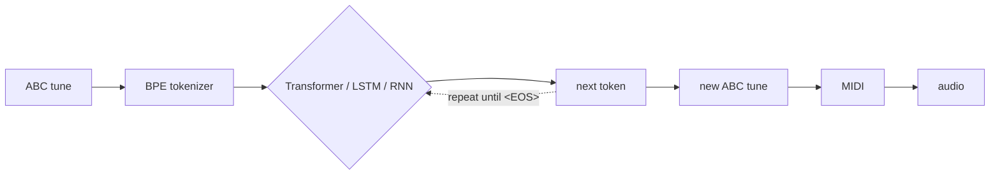

<div align="center">
  
  <h1>MGTLR: Music Generator using Transformer, LSTM, and RNN</h1>
  <p><b>Three neural networks written from scratch in PyTorch that compose folk tunes in ABC notation.</b></p>

  [](pyproject.toml)
  [](https://pytorch.org)
  [](https://huggingface.co/datasets/sander-wood/irishman)
  [](app/main.py)
  [](docs/testing.md)
</div>

---

## Table of Contents 📘
- [About The Project](#about-the-project)
- [Features](#features)
- [Quick Start](#quick-start)
- [The Three Models](#the-three-models)
- [Training](#training)
- [Some Examples](#examples-of-songs-generated)
- [Documentation](#documentation)
- [Project Structure](#project-structure)
- [License](#license)
- [About Me](#about-me)

---

## About The Project

<div align="center">
  <h3>Interface of our app</h3>
  
</div>

MGTLR treats music as a language. Tunes are written in
[ABC notation](https://abcnotation.com/), a text format for melodies
(`X:1 M:6/8 K:G GAB cBA | ...`). A **byte-level BPE tokenizer** turns them into
tokens, and a language model learns to predict the next token. The project
implements three models for that task, side by side, from scratch:

- a GPT-style **Transformer** with causal self-attention,
- an **LSTM**, with hand-written gates,
- a vanilla **RNN**.

All three share the same tokenizer, data pipeline, training loop and
generation code, so they can be compared fairly. A generated tune is converted
to MIDI and audio and played in a Streamlit app.

The methods carry over to other kinds of music and audio: adapt the input of
the models (the tokenizer) to the new format.



---

## Features

- **Three architectures from scratch**: Transformer, LSTM and RNN. The
  LSTM/RNN cells can also run on the cuDNN kernels (`--impl torch`), and a unit
  test proves both implementations give identical outputs.
- **Own BPE tokenizer** for ABC notation (byte level, no unknown tokens).
- **One training loop** for every model: AdamW, warmup + cosine schedule,
  mixed precision, gradient accumulation, best/last checkpoints, resume, loss
  and accuracy curves.
- **Command-line tools**: `mgtlr-tokenizer`, `mgtlr-train`, `mgtlr-generate`.
- **Streamlit app**: pick a model, write the first notes, listen to the result
  and download it as MP3 / MIDI, with the ABC annotations shown.
- **Tested**: 79 CPU-only unit tests plus an overfit sanity check on real data.
- **Backwards compatible**: checkpoints and tokenizers from the original
  version of this project still load.

---

## Quick Start

```bash
# 1. clone and install (Python >= 3.10)
git clone https://github.com/benisalla/MGTLR.git && cd MGTLR
python -m venv .venv && source .venv/bin/activate
pip install -e '.[dev]'

# 2. check that everything works (CPU, offline, ~1 min)
pytest

# 3. train a model (the dataset and tokenizer are prepared automatically)
mgtlr-train --model transformer          # or: --model lstm / --model rnn

# 4. generate tunes (.abc + .mid in outputs/)
mgtlr-generate --checkpoint checkpoints/transformer/best.pt --num-tunes 3 --midi

# 5. or open the app
pip install -e '.[app]'
streamlit run app/main.py
```

> **No pretrained weights are included in the repository.** Train a model
> first (step 3); it is saved in `checkpoints/<model>/best.pt`.

---

## The Three Models

| | Transformer | LSTM | RNN |
|---|---|---|---|
| core | 5 pre-norm blocks, 4-head causal self-attention, GELU MLP | 2 stacked LSTM layers | 2 stacked tanh RNN layers |
| sizes | d_model 128, context 1024 | embedding 128, hidden 256 | embedding 128, hidden 256 |
| parameters | 1.23M | 1.25M | 0.56M |
| training window | 512 tokens | 200 tokens | 200 tokens |
| generation | re-reads its context | carries its hidden state | carries its hidden state |

All three read the same tokens (859-token BPE vocabulary) and predict the next
one. See [docs/architecture.md](docs/architecture.md) for the equations and
tensor shapes.

---

## Training

```bash
mgtlr-train --model transformer
mgtlr-train --model lstm --impl torch      # fast cuDNN LSTM
mgtlr-train --model rnn --hidden-dim 512 --max-steps 40000
```

Every hyperparameter is a flag (`mgtlr-train --help`). Each model starts from
the preset of the original project. Full guide:
[docs/training.md](docs/training.md).

#### Results of Training Different Models

1. **Transformer (TRF)**

   

2. **Recurrent Neural Network (RNN)**

   

3. **Long Short-Term Memory (LSTM)**

   

### Fine-Tuning

To continue training a model (more steps, or new tunes with `--train-file`):

```bash
mgtlr-train --model transformer --resume checkpoints/transformer/last.pt --max-steps 40000
```

---

### Examples of Songs Generated

Here are some examples of songs generated by the MGTLR model:

https://github.com/benisalla/music_generator_with_3_nlp_algorithms/assets/89405673/cdc9c03f-4a22-4776-98ae-71d532800ff6

https://github.com/benisalla/music_generator_with_3_nlp_algorithms/assets/89405673/93f4042f-d17a-4382-8d0a-7e54632d321c

https://github.com/benisalla/music_generator_with_3_nlp_algorithms/assets/89405673/ae2c34ea-89cc-4bc8-aaf5-88d92422a8d1

https://github.com/benisalla/music_generator_with_3_nlp_algorithms/assets/89405673/f1cb56e8-1963-4234-9087-fff7cb875333

https://github.com/benisalla/music_generator_with_3_nlp_algorithms/assets/89405673/3c882167-ec4a-4f57-811f-1725255e4da7

https://github.com/benisalla/music_generator_with_3_nlp_algorithms/assets/89405673/f1eeb63e-0b8e-45db-b26e-0ddb39ad65d6

https://github.com/benisalla/music_generator_with_3_nlp_algorithms/assets/89405673/f2175c77-c903-415c-be10-69fd5248ed65

https://github.com/benisalla/music_generator_with_3_nlp_algorithms/assets/89405673/0001222a-20cf-4f1b-85b5-d06d77c7398e

https://github.com/benisalla/music_generator_with_3_nlp_algorithms/assets/89405673/338f7ff4-f0e6-47fd-a5b4-55ec13e28736

https://github.com/benisalla/music_generator_with_3_nlp_algorithms/assets/89405673/eeccf4e8-d8a2-45f9-9cfe-bec4bf6bfbcf

---

## Documentation

| Guide | What is inside |
|-------|----------------|
| [docs/training.md](docs/training.md) | data, tokenizer, training each model, every flag, resume, outputs |
| [docs/inference.md](docs/inference.md) | generating tunes (CLI and Python), the Streamlit app, audio setup |
| [docs/testing.md](docs/testing.md) | unit tests, the overfit sanity check on real data, what each test proves |
| [docs/architecture.md](docs/architecture.md) | tokenizer, Transformer, LSTM and RNN with equations and shapes |

---

## Project Structure

```
MGTLR
├── src/mgtlr/              the package (read in this order)
│   ├── config.py           every hyperparameter + one preset per model
│   ├── tokenizer.py        byte-level BPE tokenizer (+ a character baseline)
│   ├── data.py             IrishMAN download, <SOS>/<EOS> framing, random token windows
│   ├── models/
│   │   ├── base.py         shared forward contract, loss, sampling, generate()
│   │   ├── transformer.py  GPT-style Transformer (MGTransformer)
│   │   └── recurrent.py    RNN and LSTM: hand-written cells or torch kernels
│   ├── train.py            training loop + mgtlr-train CLI
│   ├── checkpoint.py       self-contained checkpoints (+ legacy format loading)
│   ├── generate.py         mgtlr-generate CLI
│   ├── train_tokenizer.py  mgtlr-tokenizer CLI
│   └── music.py            ABC -> MIDI -> WAV/MP3
├── app/                    Streamlit interface (main.py, style, background image)
├── tests/                  pytest suite (CPU only, offline)
├── docs/                   guides
├── legacy/                 the original code, kept unchanged for reference
└── pyproject.toml          dependencies and command-line tools
```

---

## Dataset

[IrishMAN](https://huggingface.co/datasets/sander-wood/irishman) (MIT licence):
214,122 training and 2,162 validation Irish folk tunes in ABC notation. It is
downloaded automatically into `data/` on first use.

---

## License

This project is made available under **fair use guidelines**. While there is no formal license associated with the repository, users are encouraged to credit the source if they utilize or adapt the code in their work. This approach promotes ethical practices and contributions to the open-source community. For citation purposes, please use the following:

```bibtex
@misc{mg_transformer_2024,
  title={MGTLR: Music Generator using Transformer, LSTM, and RNN},
  author={Ben Alla Ismail},
  year={2024},
  url={https://github.com/benisalla/MGTLR}
}
```

---

## About Me

🎓 **Ismail Ben Alla** - Neural Network Enthusiast

As a dedicated advocate for artificial intelligence, I am deeply committed to exploring its potential to address complex challenges and to further our understanding of the universe. My academic and professional pursuits reflect a relentless dedication to advancing knowledge in AI, deep learning, and machine learning technologies.

### Core Motivations
- **Innovation in AI**: Driven to expand the frontiers of technology and unlock novel insights.
- **Lifelong Learning**: Actively engaged in mastering the latest technological developments.
- **Future-Oriented Vision**: Fueled by the transformative potential and future prospects of AI.

I am profoundly passionate about my work and optimistic about the future contributions of AI and machine learning.

**Let's connect and explore the vast potential of artificial intelligence together!**
<div align="center">
  <a href="https://twitter.com/ismail_ben_alla" target="_blank">
    
  </a>

  <a href="https://linkedin.com/in/ismail-ben-alla-7144b5221/" target="_blank">
    
  </a>

  <a href="https://instagram.com/ismail_ben_alla" target="_blank">
    
  </a>
</div>

---

<div align="center">
  <h4>🎵✨🎶 Hit play and let the magic begin—watch notes turn into symphonies! 🎵✨🎶</h4>
  
</div>
