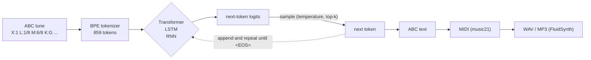

# Architecture

All three models are **next-token language models over ABC notation**. They
read token ids and predict the next one; music comes out by sampling one token
at a time. Only the network in the middle changes.



## Data and tokenizer

* **Dataset**: [IrishMAN](https://huggingface.co/datasets/sander-wood/irishman),
  214,122 training and 2,162 validation tunes in ABC notation (MIT licence).
* **Corpus**: every tune is framed as `<SOS>tune<EOS>` and the tunes are joined
  with blank lines into one text (`data.format_corpus`).
* **Tokenizer** (`tokenizer.MGTokenizer`): byte-level BPE with a GPT-4 style
  pre-split regex. 256 byte tokens + 600 learned merges + `<PAD>`, `<SOS>`,
  `<EOS>` = **859 ids**. Every byte is in the base vocabulary, so nothing is
  ever out of vocabulary. On IrishMAN it compresses ~1.74 characters per token
  (62.1M characters -> 35.8M tokens).
* **Batches** (`data.TokenStream`): random windows of `seq_len + 1` tokens from
  the stream; input = `window[:-1]`, target = `window[1:]`. Windows may cross
  tune boundaries, which is how the models learn to write `<EOS>`.

| shape | meaning |
|-------|---------|
| `x, y: [B, T]` | input ids and targets (targets = inputs shifted by one) |
| `logits: [B, T, V]` | next-token scores at every position (V = 859) |
| `loss` | mean cross-entropy over all `B * T` positions |

## Transformer (`models/transformer.py`)

A GPT-style decoder written from scratch (the original `MGTransformer`):

```
ids [B, T] -> tok_emb + pos_emb [B, T, 128]
           -> 5 x Block:  x = x + Attn(LN(x));  x = x + MLP(LN(x))
           -> LN -> lm_head (weights tied with tok_emb) -> [B, T, 859]
```

* causal multi-head self-attention, 4 heads of 32 dims, fused
  `scaled_dot_product_attention` kernel;
* MLP 128 -> 512 -> 128 with GELU; LayerNorm without bias;
* learned positions up to `max_seq_len = 1024`; trained on 512-token windows;
* GPT-2 init: N(0, 0.02), residual projections scaled by `1/sqrt(2 * n_layers)`;
* **1.23M parameters** with the default preset.

The parameter names are the same as in the original code, so the legacy
checkpoints (`mg_chpts_v1.pth`) load unchanged.

## LSTM and RNN (`models/recurrent.py`)

```
ids [B, T] -> embedding [B, T, 128] -> 2 stacked recurrent layers [B, T, 256]
           -> Linear -> [B, T, 859]
```

| cell | equations |
|------|-----------|
| RNN  | `h_t = tanh(W_ih x_t + W_hh h_{t-1})` (or ReLU) |
| LSTM | `i, f, g, o = split(W_ih x_t + W_hh h_{t-1})`; `c_t = σ(f)·c_{t-1} + σ(i)·tanh(g)`; `h_t = σ(o)·tanh(c_t)` |

Each layer has **one** cell whose weights are shared over all time steps.
Two implementations, chosen with `--impl`:

* `scratch` (default): the cells above, written with two `nn.Linear` and
  unrolled over time in Python. Every operation is visible; slower.
* `torch`: `nn.RNN` / `nn.LSTM` (cuDNN on GPU, much faster).

The weight layouts match. `tests/test_models.py::test_scratch_matches_torch`
copies the weights from one implementation into the other and checks that the
outputs are identical.

Default sizes: LSTM **1.25M** parameters, RNN **0.56M**. Both train on
200-token windows.

During generation the recurrent models keep their hidden state and read only
the newly sampled token at each step. The Transformer has no state: it re-reads
its last `max_seq_len` tokens at every step.

## Training (`train.py`)

One loop serves the three models:

* AdamW; weight decay only on matrices and embeddings, not on norms or biases;
* linear warmup, then cosine decay from `lr` to `min_lr`;
* gradient clipping (1.0), optional gradient accumulation, label smoothing;
* mixed precision on CUDA (bf16 when supported, otherwise fp16 with a grad scaler);
* validation on the same fixed windows every time (seeded): loss, next-token
  accuracy, perplexity;
* writes `last.pt` and `best.pt` (lowest validation loss), `history.json`
  and `training_curves.png`. `--resume` continues a run.

Checkpoints are self-contained: weights, model config, train config and the
tokenizer merges. `musicgen-generate` needs nothing else.
